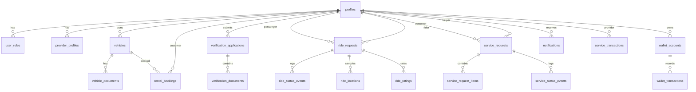

# SurGo — Database Overview

## 1. Summary

SurGo uses a Supabase Postgres database with:

- **30 tables** defined by the local migration set;
- **24 enums**;
- RLS enabled on every public table;
- a **read-only client baseline** (no client write policies);
- **admin-only read policies** and audited `SECURITY DEFINER` functions;
- three storage buckets (`avatars`, `verification-documents`, `vehicle-documents`).

The **hosted project currently has 26 tables and 18 enums** because the four local-only financial migrations have not been applied. This is a deliberate distinction, not a defect to hide.

## 2. Hosted vs. local state

| Item | Local repository | Hosted project |
| --- | --- | --- |
| Migration files | 19 | 15 applied |
| Public tables | 30 | 26 |
| Enums | 24 | 18 |
| Financial ledger tables | Present locally | Not applied |
| Financial RPCs | Present locally | Not applied |
| Admin dashboard access | Present | Applied (recorded as version `20261106062246`, name `admin_dashboard_access_and_actions`) |
| Demo data | Generated from `assets/db/*.json` | Applied on 2026-11-06 |

### Applied hosted migrations

```
20261106062246  admin_dashboard_access_and_actions
20261106090000  helpers
20261106090100  enums
20261106090200  catalog_and_pricing
20261106090300  identity_and_verification
20261106090400  rides
20261106090500  rentals
20261106090600  service_requests
20261106090700  money
20261106090800  engagement
20261106090900  auth_profile_trigger
20261106091000  storage_buckets
20261106091100  realtime_publication
20261106091200  rls_baseline
20261106130000  security_hardening
```

### Local-only migrations (not on hosted)

```
20261106140000  pricing_versions
20261106140100  financial_ledger
20261106140200  financial_rpc
20261106140300  financial_reporting
```

These add `cash_collections`, `cash_payment_disputes`, `platform_fee_receivables`, `provider_fee_remittances`, six financial enums, and functions such as `calculate_service_price`, `settle_service_transaction`, `confirm_cash_collection`, `open_cash_payment_dispute`, and `record_provider_fee_remittance`.

> **Defense guidance:** do not claim the hosted project has the financial ledger. Present it as designed and locally tested, pending deployment.

## 3. Table groups

### Identity and access

| Table | Purpose |
| --- | --- |
| `profiles` | One row per person; name, contact, rating, account status. |
| `user_roles` | Approved/pending/suspended/revoked roles per profile. |
| `provider_profiles` | Earner/owner capability flags and service area. |
| `verification_applications` | Capability verification applications and status. |
| `verification_documents` | Documents attached to an application. |
| `vehicles` | Owned/listed vehicles. |
| `vehicle_documents` | OR/CR, insurance, permit documents. |

### Geography and catalog

| Table | Purpose |
| --- | --- |
| `service_areas` | City/service-area definitions. |
| `barangays` | Barangay catalog. |
| `puroks` | Sub-barangay units. |
| `pricing_policies` | Versioned pricing policies (currently empty in demo data). |

### Rides

| Table | Purpose |
| --- | --- |
| `ride_requests` | Ride request, participants, fare, status. |
| `ride_status_events` | Status transition history. |
| `ride_locations` | Location samples for a ride. |
| `ride_ratings` | Passenger/rider ratings. |

### Rentals

| Table | Purpose |
| --- | --- |
| `rental_bookings` | Rental request, dates, vehicle, owner, status. |

### Pasuyo / service requests

| Table | Purpose |
| --- | --- |
| `service_requests` | Errand request, customer, helper, budget, status. |
| `service_request_items` | Shopping/errand line items. |
| `service_status_events` | Status transition history. |

### Money

| Table | Purpose |
| --- | --- |
| `service_transactions` | Settlement record for a completed service. |
| `wallet_accounts` | Wallet balance per profile and account type. |
| `wallet_transactions` | Ledger entries. |
| `cash_fee_remittances` | Cash platform-fee remittance records. |
| `cash_collections` | Local-only cash collection records. |
| `cash_payment_disputes` | Local-only cash disputes. |
| `platform_fee_receivables` | Local-only receivables. |
| `provider_fee_remittances` | Local-only provider remittances. |

### Engagement and administration

| Table | Purpose |
| --- | --- |
| `notifications` | In-app notification feed. |
| `device_tokens` | Push token registry. |
| `admin_audit_logs` | Audit trail written by admin RPCs. |

## 4. Key enums

| Enum | Values |
| --- | --- |
| `account_status` | `active`, `suspended` |
| `user_role_type` | `passenger`, `earner`, `rider`, `vehicle_owner`, `admin` |
| `role_approval_status` | `pending`, `approved`, `suspended`, `revoked` |
| `provider_type` | `earner`, `vehicle_owner` |
| `earner_capability` | `rides`, `errands`, `deliveries` |
| `vehicle_status` | `pending_verification`, `active`, `inactive`, `suspended` |
| `document_review_status` | `pending`, `approved`, `rejected`, `expired` |
| `verification_status` | `draft`, `submitted`, `under_review`, `approved`, `rejected`, `needs_resubmission` |
| `ride_status` | `searching`, `awaiting_acceptance`, `accepted`, `heading_to_pickup`, `arrived`, `in_progress`, `completed`, `cancelled` |
| `rental_status` | `requested`, `awaiting_owner`, `accepted`, `active`, `returned`, `completed`, `declined`, `cancelled` |
| `pasuyo_status` | `available`, `accepted`, `going_to_pickup`, `at_pickup`, `picked_up`, `delivering`, `at_customer`, `delivered`, `cancelled` |
| `pasuyo_category` | `groceries`, `food_delivery`, `pharmacy`, `parcel`, `laundry`, `other` |
| `service_type` | `ride`, `rental`, `pasuyo` |
| `transaction_status` | `pending`, `completed`, `voided`, `refunded`, `failed` |
| `wallet_account_type` | `passenger`, `earner`, `provider`, `platform` |
| `wallet_transaction_type` | Ledger entry types |
| `remittance_status` | Remittance states |
| `device_platform` | `android`, `ios`, `web` |

The six financial enums (`platform_fee_mode`, `platform_fee_type`, `cash_collection_status`, `cash_dispute_status`, `platform_fee_receivable_status`, `fee_remittance_status`) exist only in the local financial migrations.

## 5. Entity relationships (simplified)



## 6. RLS model

### Baseline (hosted)

RLS is enabled on every public table. The baseline grants reads only:

- public catalog (`service_areas`, `barangays`, `puroks`) readable by authenticated users;
- active `pricing_policies` readable;
- `profiles`, `user_roles`, `wallet_*`, `notifications`, `device_tokens`, `cash_fee_remittances` scoped to the current user;
- `provider_profiles` readable for provider discovery;
- vehicles readable when listed or owned;
- ride/rental/Pasuyo rows readable only by participants;
- verification rows readable only by the owner.

### What is deliberately absent

- **No client INSERT/UPDATE/DELETE policies.** The app cannot write business tables with the publishable key.
- **No client grant on `admin_audit_logs`.** It is written by `SECURITY DEFINER` RPCs and read through `service_role`.
- **No broad admin table access from the browser.** The admin dashboard reads through migration-14 `admin_read_*` policies and calls audited RPCs.

### Admin security

- `is_admin()` checks for an approved `admin` row in `user_roles`.
- Five write RPCs re-check `is_admin()` and write an audit row.
- Admin read policies cover the tables the dashboard needs.
- Storage reads use the signed-in admin's session; document previews use 600-second signed URLs.

## 7. Auth trigger

`on_auth_user_created` calls `public.handle_new_auth_user()`, which:

1. creates a `profiles` row from the auth user's metadata;
2. grants an approved `passenger` role.

`on_auth_user_updated` keeps profile contact fields aligned with auth changes.

This means every newly created Supabase user starts as a passenger. Additional capabilities require an approved role row.

## 8. Demo data

### Source pipeline

```
assets/db/*.json
  -> supabase/tools/gen_demo_data.mjs
  -> supabase/demo-data.sql
  -> PGlite verification (twice)
  -> hosted apply
```

`demo-data.sql` is not a migration. It is an idempotent block of upserts keyed by deterministic UUIDs (`md5('surgo:demo:<kind>:<key>')::uuid`). It lives outside `migrations/` and `seed.sql`.

### Hosted row counts (verified)

| Table | Rows |
| --- | --- |
| `profiles` | 20 |
| `user_roles` | 60 |
| `provider_profiles` | 15 |
| `vehicles` | 14 |
| `ride_requests` | 19 |
| `rental_bookings` | 16 |
| `service_requests` | 20 |
| `service_transactions` | 29 |
| `verification_applications` | 3 |
| `notifications` | 25 |
| `wallet_accounts` | 11 |
| `wallet_transactions` | 79 |
| `cash_fee_remittances` | 0 |

### Demo data rules

- **Demo auth accounts are banned.** Each demo person has an `auth.users` row with no password and `banned_until = 'infinity'`. They cannot sign in.
- **The real account is separate.** The operator's admin account (identified locally by `SURGO_REAL_USER_ID` / `SURGO_REAL_USER_EMAIL`) is unbanned but has an **email identity only**, so it is the admin-dashboard account, not a Flutter login. At the time of writing it has approved roles `passenger` and `admin` only.
- **Cash only.** `payment_method` stays `cash`; GCash/Maya mentions are preserved in notes.
- **No platform fees in demo rows.** `service_transactions.platform_fee_centavos = 0`; `pricing_policies` is empty.
- **Wallets reconcile by construction.** An opening adjustment is derived from the JSON balance minus its ledger.
- **Ratings below 1.0 are clamped up to 1.00** in the hosted import; a value already at or above 1.0 (e.g., `RV005` 1.1) is left unchanged.
- **Ownership follows foreign keys**, not JSON labels.
- **`RV005` keeps `service_area_id = null`** because its plate duplicates `NGD 6612` under a partial unique index.

## 9. Seed-data issues to know before presenting

These are local seed inconsistencies, not necessarily hosted defects:

| Issue | Detail | Risk |
| --- | --- | --- |
| Implausible ratings | Local `vehicles.json` has `RV005` 1.1, `RV006` 0.6, `RV008` 0.9, `RV009` 0.8, `RV010` 0.5, `RV013` 0.8, `RV014` 0.9 | A panelist may notice; hosted import clamps sub-1.0 values to 1.00, while `RV005`'s 1.1 stays 1.10 |
| Duplicate plate | `RV004` and `RV005` both use `NGD 6612` | Looks like a data-quality bug |
| Capability/history mismatch | Some seeded people have history in services they are not approved for | Confusing if inspected closely |
| Unresolved pricing | Pasuyo 15% and rental 10% legacy commissions remain | Do not present as final policy |
| Stale docs | `README.md` says 10% ride commission and "no screen reads the database" | Contradicted by code |

## 10. Pricing data

`assets/db/config.json` (schema version 3) defines:

```json
{
  "commissionBps": { "pasuyo": 1500, "rental": 1000 },
  "platformFee": {
    "perKmCentavos": 200,
    "minCentavos": 500,
    "maxCentavos": 3000
  },
  "fare": { "baseFare": 5000, "perKm": 125000, "minimumFare": 5000 },
  "payouts": { "minWithdrawal": 30000, "arrivalDays": 2 }
}
```

- Ride platform fee = `min(₱30, max(₱5, distanceKm × ₱2))`, paid by the customer on top of the provider fare.
- The provider keeps 100% of the ride fare.
- Pasuyo and rental commissions are legacy and unresolved.
- All money is integer centavos; `Money.format` is the only renderer.

## 11. Database claims safe to make

- "The schema covers identity, catalog, rides, rentals, Pasuyo, money, engagement, and administration."
- "RLS is enabled on every public table, with a read-only client baseline."
- "Admin actions run through audited server-side functions, not browser writes."
- "The hosted project has demo rows for 19 demo people plus the real account."
- "The financial ledger is designed and locally tested but not yet deployed."

## 12. Database claims to avoid

- "All writes are persisted to Supabase." — They are not.
- "The financial ledger is live." — It is local-only.
- "Demo accounts can be used to sign in." — They are banned.
- "Pricing is final for Pasuyo and rentals." — It is unresolved.
- "The admin dashboard has been fully browser-tested against production." — It has not.
