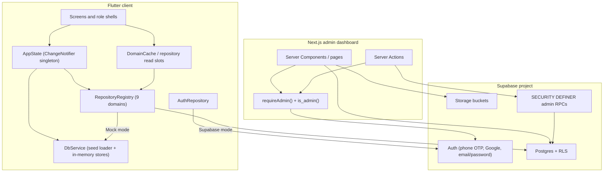
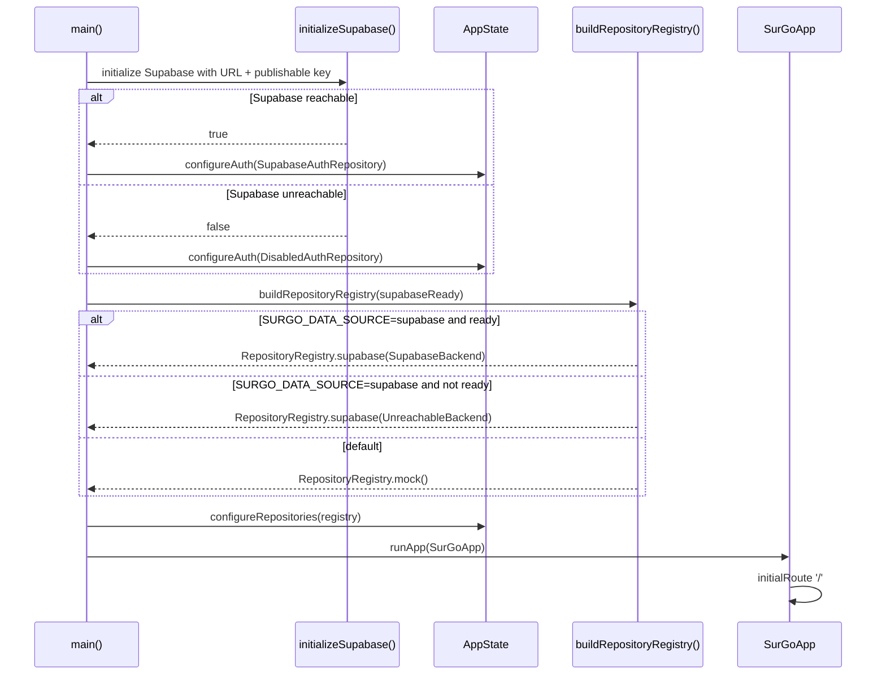
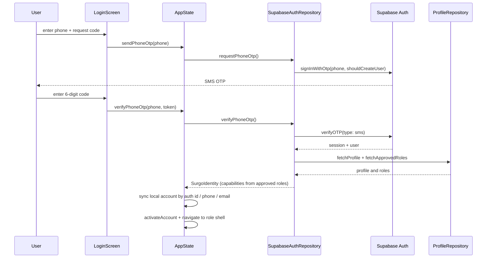
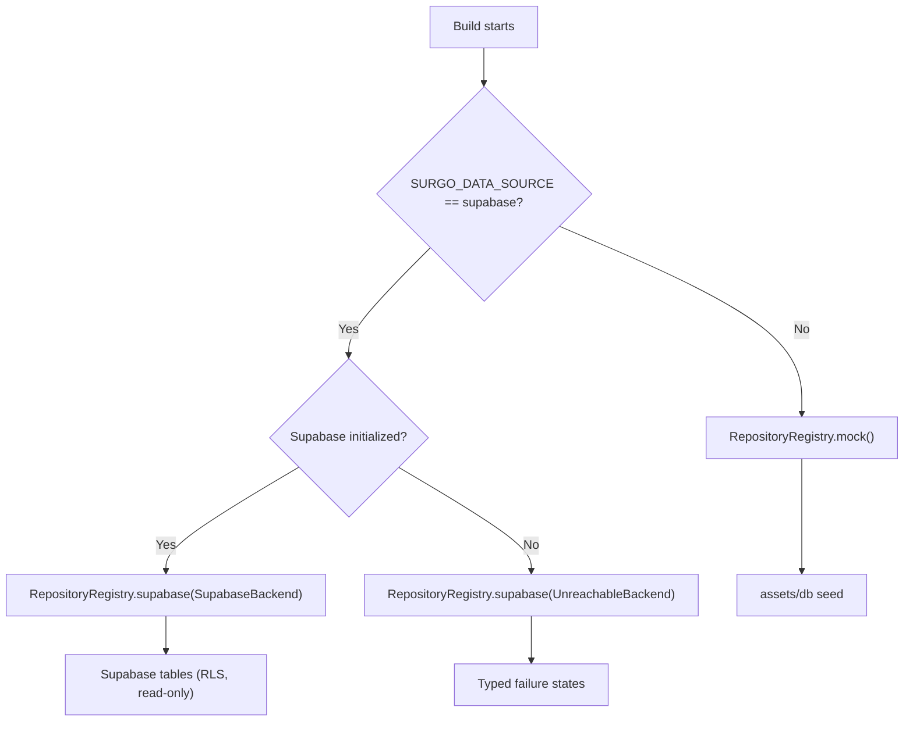
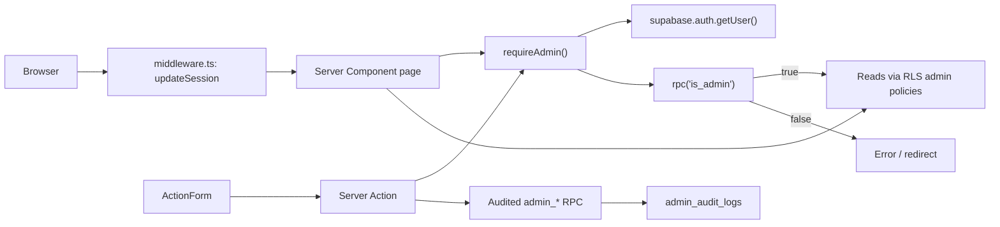
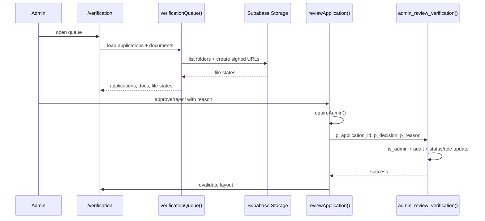

# SurGo — System Architecture

## 1. Architectural summary

SurGo has three deployable parts:

1. **Flutter client** — the product experience for passengers, riders/helpers, and vehicle owners.
2. **Supabase project** — identity, Postgres schema, RLS, storage buckets, and audited admin functions.
3. **Next.js admin dashboard** — a server-rendered web app for administrators.

The client is deliberately split between a **live identity layer** and a **prototype business layer**. Authentication is real. Business data reads can be real (opt-in). Business writes are mostly in-memory.

## 2. Flutter boot sequence

`lib/main.dart` is the composition root.

### Important boot facts

- The Supabase URL and **publishable** key are embedded defaults in `lib/services/supabase_bootstrap.dart`. They can be overridden with `--dart-define=SUPABASE_URL` and `--dart-define=SUPABASE_PUBLISHABLE_KEY`.
- A `SURGO_DATA_SOURCE=supabase` build that cannot reach Supabase still receives Supabase repositories backed by `UnreachableBackend`. It fails with typed errors rather than silently serving seed data.
- The default build uses **mock business data** even though auth is live. This is the intended demo configuration.
- `AppState` starts with `MockAuthRepository` as a field initializer, but `main()` always replaces it with `SupabaseAuthRepository` or `DisabledAuthRepository`. The fixed OTP is therefore a test/preview facility, not a production path.

## 3. Client layers

### 3.1 Screens and role shells

Each role is a `PageView` shell with tabs:

- `PassengerShell` — Home, Activity, Wallet, Profile.
- `RiderShell` (route `/earner`) — Home, Trips, Earnings, Profile.
- `VehicleOwnerShell` — Home, Bookings, Earnings, Profile.

Pushed routes cover booking, matching, live trip, chat, rental list/detail, active rental, Pasuyo hub/post/task, maps, verification, settings, and rating.

### 3.2 `AppState`

`AppState` is a `ChangeNotifier` singleton and the center of business behaviour. It owns:

- active account and identity;
- role/capability gates;
- ride requests, proposals, active ride, completion;
- Pasuyo tasks and lifecycle;
- rental bookings and owner approval timers;
- wallet balances, transactions, payouts;
- notifications, settings, saved places, emergency contacts;
- verification applications and simulated review timers;
- earnings and platform ledger.

Most mutations write to `DbService` lists in memory. A page reload restores the seed.

Ride status is one enum path: `advanceRide()` uses `RideStatus.next`, and `completeActiveRide()` only succeeds from `inProgress`. The Live Trip screen listens to `AppState`, renders the action the current status offers, and shows an explicit empty state when there is no active trip. No screen can skip a state or settle early (`test/live_trip_widget_test.dart` pins the passenger-side path).

### 3.3 `DbService`

`DbService` loads `assets/db/manifest.json` and the declared JSON files:

- `config.json`
- `users.json`
- `accounts.json`
- `applications.json`
- `locations.json`
- `vehicles.json`
- `rides.json`
- `rentals.json`
- `wallets.json`
- `earnings.json`
- `pasuyo.json`
- the map V1 asset

It also owns per-profile wallet, notification, and settings maps, and `activateAccount()` swaps the visible passenger/earner/owner slices.

### 3.4 Repository registry

`RepositoryRegistry` binds nine domains to either mock or Supabase implementations. There is no per-call fallback between the two.

| Domain | Interface | Mock | Supabase |
| --- | --- | --- | --- |
| Profiles / roles | `ProfileRepository` | `MockProfileRepository` | `SupabaseProfileRepository` |
| Catalog / places / pricing | `CatalogRepository` | `MockCatalogRepository` | `SupabaseCatalogRepository` |
| Vehicles | `VehicleRepository` | `MockVehicleRepository` | `SupabaseVehicleRepository` |
| Rides | `RideRepository` | `MockRideRepository` | `SupabaseRideRepository` |
| Rentals | `RentalRepository` | `MockRentalRepository` | `SupabaseRentalRepository` |
| Pasuyo | `PasuyoRepository` | `MockPasuyoRepository` | `SupabasePasuyoRepository` |
| Notifications | `NotificationRepository` | `MockNotificationRepository` | `SupabaseNotificationRepository` |
| Wallet | `WalletRepository` | `MockWalletRepository` | `SupabaseWalletRepository` |
| Verifications | `VerificationRepository` | `MockVerificationRepository` | `SupabaseVerificationRepository` |

### 3.5 Where repositories are actually read

Repository reads are used by eight screens:

| Screen | Reads |
| --- | --- |
| `home_screen.dart` | Passenger profile, unread badge, Recent Bookings (`fetchRideHistory`, limit 3, terminal rides only) |
| `notifications_screen.dart` | Passenger or earner notification feed, newest first, with ages from `createdAt` |
| `profile_screen.dart` | Profile and approved roles |
| `rider_home_screen.dart` | Earner profile header and unread badge |
| `vehicle_documents_screen.dart` | Owner-fleet vehicle documents, read through the owner's vehicles |
| `vehicle_owner_home_screen.dart` | Owner fleet preview |
| `vehicle_owner_vehicles_screen.dart` | Owner fleet |
| `wallet_screen.dart` | Passenger, earner, or owner wallet balance and ledger entries |

Most other screens still read `AppState`/`DbService` directly. This is the central architectural gap: **the repository layer exists and is used for selected reads, but it is not yet the only data path.**

### 3.6 `DomainCache`

`DomainCache` holds repository read slots in explicit loading, empty, failure, and data states. Screens use `RepositoryView`/`RepositoryInline` widgets to render those states, with retry.

The slots now include:

- `profile` and `profileRoles`;
- `passengerProfile` and `earnerProfile`;
- `barangays`;
- `unreadPassengerNotifications` and `unreadEarnerNotifications`;
- `passengerNotificationFeed` and `earnerNotificationFeed`;
- `passengerRecentRides` (`fetchRideHistory`, limit 3, completed/cancelled only);
- three wallet balances and three wallet-entry lists (passenger, earner, owner);
- `ownerFleet`;
- `ownerVehicleDocuments` (read through the owner's vehicle ids, because `vehicle_documents` has no owner column).

Mock reads mirror the in-memory seed and re-run when app data changes; Supabase reads are not re-fetched on unrelated app notifications and never fall back to seed rows on failure.

**Session-change fix (verified):** a read that is still in flight when the identity changes is retired by a per-slot generation counter, and the request that was parked behind it re-runs once for the new profile key. This prevents the previous session's row from landing in the new session's cache. Tests cover three cases: a stale answer never appears, several restarts collapse into one re-read, and a failed re-read remains a failure the screen can retry (`test/domain_cache_test.dart`, group "session changes during a parked read"). `AppState` calls `cache.restart()` after session restore and sign-out.

## 4. Authentication architecture

### Capability mapping

Approved `user_roles.role` values map to app capabilities:

| Supabase role | App capability |
| --- | --- |
| `passenger` | Passenger |
| `earner` | Earner (rider/helper) |
| `rider` | Rider + Earner |
| `vehicle_owner` | Vehicle owner |

`admin` is tracked on the identity but does not unlock a Flutter mode; the admin dashboard is a separate app.

### Identity-to-seed bridge

`AppState._syncLocalAccount()` calls `DbService.findAccountForIdentity()`:

1. match by Supabase auth user id;
2. otherwise match by normalized phone;
3. otherwise match by lower-cased email;
4. otherwise create a fresh local passenger account with an empty wallet.

Capabilities always come from **Supabase roles**, not from the seed account. This matters for the live demo: a real Supabase account with only `passenger` and `admin` roles will see only Passenger mode in Flutter, even if a similarly named seed account has more capabilities.

### Failure behaviour

- If profile or role reads fail, the identity loader falls back to passenger capability rather than locking a valid session out.
- If Supabase cannot initialize, `DisabledAuthRepository` returns a clear "sign-in is unavailable" failure.
- There is no offline credential cache or password login in the Flutter app.

## 5. Data modes

### Read-only Supabase mode

The hosted RLS baseline grants `SELECT` only. There are **no client write policies**. In `SURGO_DATA_SOURCE=supabase`, screens can read live tables, but writes still go to `AppState` memory. This means:

- data can look inconsistent between screens that read live and screens that read memory;
- a write in Supabase mode is not persisted;
- notification read state is not written back, so a read badge can return after refresh;
- the mode is suitable for read verification, not for a transactional demo.

For the defense, the default **live auth + mock business data** mode is more coherent.

## 6. Admin dashboard architecture

The admin app lives in `lib/admin/` and is a separate Next.js 14 project.

### Pages

| Route | Purpose |
| --- | --- |
| `/login` | Email + password sign-in |
| `/dashboard` | Overview metrics, daily activity, recent rides/users, attention list |
| `/verification` | Verification applications and vehicle document review |
| `/users`, `/users/[id]` | User list and per-person record |
| `/vehicles` | Vehicle review/status |
| `/rides`, `/rides/[id]` | Ride list and detail |
| `/rentals` | Rental bookings |
| `/pasuyo` | Service requests |
| `/providers` | Provider profiles |
| `/finance` | Cash fee remittances and transaction history |
| `/reports` | Windowed operational analytics |
| `/settings` | Admin settings |

### Security model

- Every action re-verifies admin server-side with `requireAdmin()`.
- The browser never writes tables directly.
- Dashboard reads run as the signed-in `authenticated` role through migration-14's ten SELECT-only `admin_read_*` policies (plus the `surgo admin read documents` storage policy), all gated on `public.is_admin()`. No service-role key is used in the browser.
- Five audited RPCs handle decisions:
  - `admin_review_verification`
  - `admin_review_document`
  - `admin_set_account_status`
  - `admin_set_vehicle_status`
  - `admin_update_remittance`
- Read RPCs: `admin_overview`, `admin_daily_activity`.
- `is_admin()` checks an approved `admin` role in `user_roles`.
- `admin_audit_logs` is written by the RPCs and is not readable by the `authenticated` role. The hardening migration withholds the table-level `SELECT` grant, so even an admin session gets SQLSTATE 42501; the log is read through `service_role` only. The settings page treats that code as "not readable by this session" instead of an error.
- Document previews use short-lived signed URLs (600 s) and report missing files honestly.

### Admin verification flow

## 7. Deployment and environment

| Item | Value / behaviour |
| --- | --- |
| Supabase project URL | `https://lrhgktxmavnhjatqzbzr.supabase.co` |
| Client key | Publishable key embedded in `supabase_bootstrap.dart` (public by design) |
| Flutter web demo | `flutter run -d chrome` |
| Admin dev server | `npm run dev` in `lib/admin/` (port 3100) |
| Admin build | `npm run build` |
| Admin tests | `npm test`, `npm run typecheck`, `npm run lint` |
| Android/iOS redirect | `io.supabase.surgo://login-callback` (must be allow-listed in Supabase) |

## 8. Architectural strengths to present

- Clear separation between identity and business data.
- Typed repository interfaces with mock and Supabase implementations.
- Centralized money handling in integer centavos.
- Server-side admin authorization and audited RPCs.
- RLS enabled across the schema with a read-only baseline.
- Honest failure states instead of silent fallback.
- Seeded demo data that makes the experience reviewable without data entry.

## 9. Architectural gaps to acknowledge

- Business writes are not persisted to Supabase.
- Repository adoption is partial; many screens bypass it.
- Flutter verification and admin verification are separate, unlinked workflows.
- No real-time dispatch between two devices.
- No payment gateway or payout integration.
- Pasuyo and rental pricing policies are unresolved.
- Admin dashboard has not been manually exercised in a browser against live Supabase (see `lib/admin/README.md`).
- Hosted project is missing the four local-only financial migrations.
