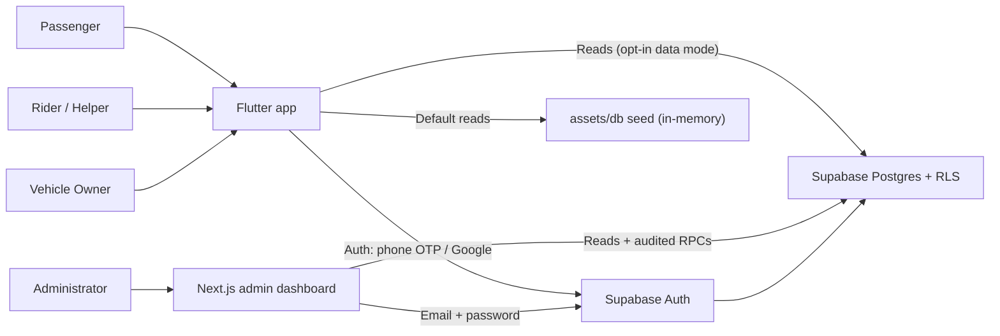

# SurGo — System Overview

## 1. What SurGo is

SurGo is a **Flutter prototype** of a multi-service mobility and delivery platform for **Tandag City, Surigao del Sur**. One account can operate in three modes:

- **Passenger** — book rides, rent vehicles, post Pasuyo errands, manage wallet, notifications, profile, and verification.
- **Rider / Helper** — go online, receive ride requests, accept trips, run Pasuyo errands, view earnings, and manage vehicle documents.
- **Vehicle Owner** — list vehicles, manage rental bookings, view rental earnings, and see listed vehicles on a map.

A separate **Next.js administrator dashboard** reads the hosted Supabase project to review verification applications, vehicles, users, rides, rentals, Pasuyo requests, finance, and reports.

The prototype is best described as:

> A working, visually complete Flutter product prototype with live Supabase authentication and a read-only Supabase data layer, where most business writes are still simulated in memory for demonstration.

That sentence should anchor the defense. It is more accurate than either "fully working app" or "UI mockup".

## 2. Intended users and value proposition

| User | Problem addressed | Prototype response |
| --- | --- | --- |
| Passenger | Multiple transport and errand apps, repeated sign-ups | One account, three modes, ride + rental + Pasuyo |
| Rider / helper | Fragmented ride and errand work | One earner mode with ride requests and Pasuyo tasks |
| Vehicle owner | Underused vehicles, manual rental coordination | Vehicle listing, rental requests, owner approval flow |
| Administrator | No visibility into verification, safety, or platform fees | Web dashboard with review queues and operational summaries |

## 3. Services in scope

1. **Rides** — pickup, destination, vehicle class, fare breakdown, rider matching, live trip, completion, rating.
2. **Vehicle rentals** — browse vehicles, choose dates, request a booking, owner approval, active rental.
3. **Pasuyo** — post an errand, helper accepts, purchasing/delivering lifecycle, completion and rating.
4. **Wallet** — passenger top-up, rider/owner cash-out, transaction history.
5. **Trust and verification** — capability-based verification (passenger, earner/rider, vehicle owner), document checklist, admin review.
6. **Notifications** — per-profile feed and unread counts.
7. **Administration** — verification, users, vehicles, rides, rentals, Pasuyo, finance, reports.
8. **Platform revenue** — ride platform fee ledger, remittance tracking in the admin dashboard.

## 4. What is genuinely working

These items are supported by real code paths and should be presented with confidence, subject to the verification checklist:

- Flutter app boots, routes, and renders all three role shells.
- Supabase Auth is initialized at boot and owns sessions when the network and project are reachable.
- Phone OTP and Google OAuth are implemented through Supabase Auth.
- Session restoration and role/capability loading are implemented.
- The app maps a Supabase identity onto the seeded business data (by auth user id, phone, or email) or creates a fresh passenger account.
- Seeded business data drives the passenger, rider, owner, Pasuyo, wallet, notification, and verification screens.
- Ride pricing follows the documented platform-fee formula and is rendered from integer centavos.
- The Next.js admin dashboard authenticates with Supabase email/password, checks `is_admin()` server-side, and calls audited `SECURITY DEFINER` RPCs for review actions.
- The admin dashboard reads live hosted tables and displays verification queues, users, vehicles, rides, rentals, Pasuyo, finance, and reports.
- RLS is enabled on all hosted public tables, with read-own/catalog baseline policies and admin-only read policies.

## 5. What is simulated or demo-only

These items must be labelled as simulated during the defense. Do not claim them as production transactions:

| Area | What is simulated |
| --- | --- |
| Rider matching | A 900 ms search delay and a 2 s automatic rider acceptance in `matching_screen.dart`. |
| Live trip | SOS alert and trip sharing show "simulated" notices; trip completion mutates in-memory state. |
| Rental approval | Owner approval fires on a 10 s timer in `app_state.dart`. |
| Wallet | Top-up and cash-out mutate in-memory balances; no payment gateway. |
| Verification (Flutter) | Submitted → under review → approved is timer-driven (`2 s`, `5 s`) inside the app. |
| Pasuyo | Full lifecycle is in-memory; the same account can act as customer and helper. |
| Business persistence | Most writes live in `AppState`/`DbService` memory and reset on reload. |
| Demo data | Seeded JSON in `assets/db/`; hosted demo rows are imported copies, and demo auth accounts are banned. |

## 6. What is not implemented

- Production payment processing (GCash, Maya, cards, escrow, refunds).
- Live GPS tracking, routing, ETA computation, or geofencing.
- Real-time ride dispatch between two devices.
- Push notifications and device-token delivery.
- Client-side writes to Supabase business tables (RLS grants reads only; no client write policies).
- Automatic synchronization between Flutter verification and the admin review workflow.
- Production pricing policy for Pasuyo and rentals (legacy percentages remain unresolved).
- Insurance, fuel, deposit, damage, late-return, and dispute handling for rentals.
- A production-grade admin grant/role-management UI.

## 7. Technology stack

| Layer | Technology |
| --- | --- |
| Mobile/client UI | Flutter (Dart 3.5+, Flutter 3.24+), Material |
| Client state | `AppState` (`ChangeNotifier` singleton), `DbService` seed loader |
| Client auth | `supabase_flutter`, phone OTP, Google OAuth |
| Client data | Repository registry with mock and Supabase implementations (read-only) |
| Backend | Supabase Postgres, Auth, Storage, Realtime publication |
| Admin dashboard | Next.js 14 App Router, React 18, TypeScript, Tailwind CSS, `@supabase/ssr` |
| Admin security | Supabase Auth session + `is_admin()` + audited `SECURITY DEFINER` RPCs |
| Testing | Flutter tests, Node test runner, PGlite SQL verification, TypeScript typecheck/lint/build |

## 8. Runtime modes

| Mode | Auth | Business data | When used |
| --- | --- | --- | --- |
| Default demo | Live Supabase Auth | Local mock seed (`assets/db/`) | `flutter run` with network; the intended defense mode |
| Supabase data | Live Supabase Auth | Supabase tables, read-only | `--dart-define=SURGO_DATA_SOURCE=supabase` |
| Offline | Disabled auth | Local mock seed | Supabase initialization fails; sign-in is unavailable |
| Test/preview | `MockAuthRepository`, fixed OTP `123456` | Local mock seed | Unit/widget tests and previews only; never installed by `main.dart` |

> **Critical:** the fixed OTP `123456` is not available in a normal build. `main.dart` always installs `SupabaseAuthRepository` or `DisabledAuthRepository`. A live demo must use real Supabase SMS OTP or Google sign-in.

## 9. System context

## 10. Honest scope statement for the defense

Use language like:

> "SurGo demonstrates the complete user experience and the security and data architecture needed for a multi-service platform. Authentication and the administrative review workflow are connected to a live Supabase project. The transactional business layer is intentionally simulated in memory so the flows can be demonstrated without moving real money. The database schema, RLS baseline, and audited admin functions are in place for the next phase: moving each write path from `AppState` to a server-side transaction."

This avoids overclaiming while still presenting substantial engineering work.

## 11. Related documents

- Architecture: [SYSTEM_ARCHITECTURE.md](SYSTEM_ARCHITECTURE.md)
- Database: [DATABASE_OVERVIEW.md](DATABASE_OVERVIEW.md)
- Workflows: [USER_WORKFLOWS.md](USER_WORKFLOWS.md)
- Feature status: [FEATURE_AUDIT.md](FEATURE_AUDIT.md)
- Readiness: [FINAL_READINESS_REPORT.md](FINAL_READINESS_REPORT.md)
