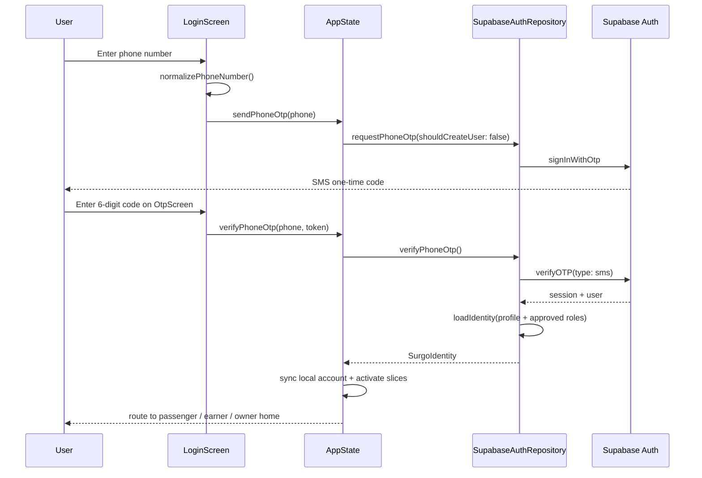
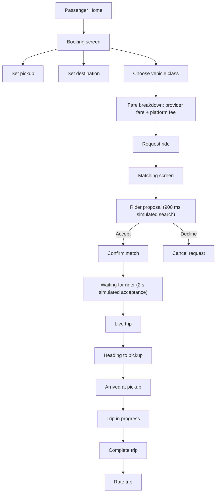
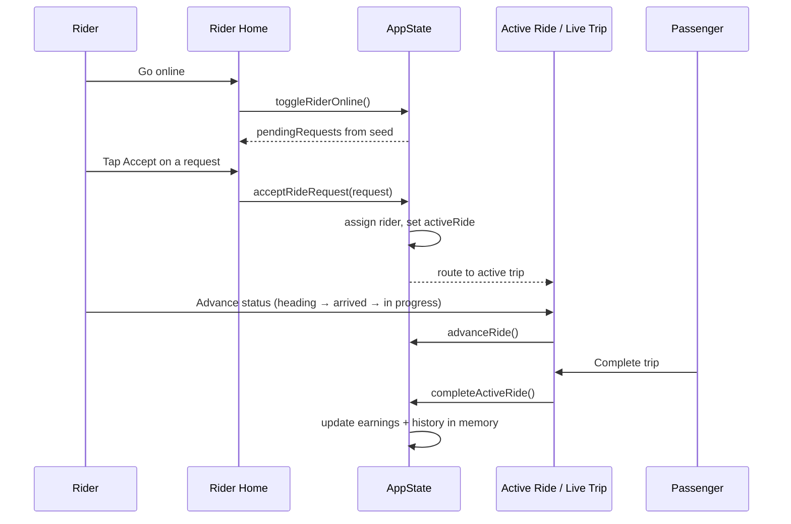
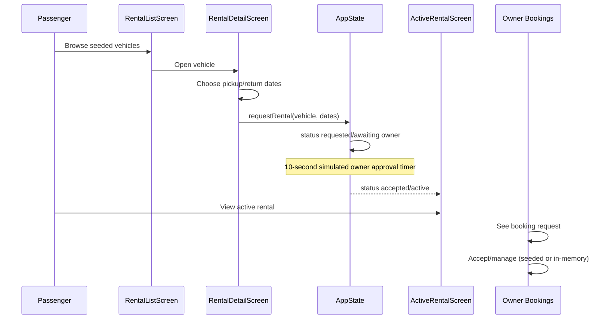
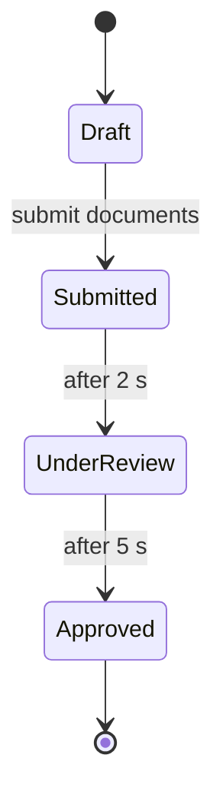

# SurGo — User Workflows

This document describes the workflows as they are implemented, with the honest status of each step. Screens exist for every flow; the question is whether the step is real, simulated, or in-memory.

## 1. Authentication and account lifecycle

### 1.1 Sign in with phone OTP

**Status:** Implemented and demonstrable (live Supabase Auth, requires SMS delivery and network).

Steps:

1. Splash screen restores any existing session.
2. Login screen accepts a phone number and requests a code.
3. OTP screen accepts six digits and resends after a 42-second cooldown.
4. Supabase verifies the code; the app loads the profile and approved roles.
5. Capabilities are derived from approved roles.
6. The app maps the identity to a seed account by auth id, phone, or email, or creates a fresh passenger account.
7. The user is routed to the highest-priority available mode.

**Failure modes:** no account, invalid code, rate limit, SMS provider failure, network failure, Supabase unreachable (`DisabledAuthRepository`).

### 1.2 Register with phone OTP

**Status:** Implemented and demonstrable.

1. Register screen collects full name and phone.
2. `sendPhoneOtp(createUser: true)` asks Supabase to create the user if absent.
3. OTP verification creates the session.
4. The auth trigger creates a profile and an approved `passenger` role.
5. The app maps or creates the local account and routes to Passenger mode.

### 1.3 Google sign-in

**Status:** Implemented but needs verification (OAuth redirect configuration is environment-dependent).

- Login and register screens call `signInWithGoogle()`.
- Native redirect: `io.supabase.surgo://login-callback`.
- The redirect must be allow-listed in the hosted Supabase project and configured in the platform app.
- Web behavior differs (`kIsWeb` passes a null redirect).

### 1.4 Account recovery

**Status:** Implemented (passwordless recovery via phone OTP).

- `ForgotPasswordScreen` collects a phone number and sends an OTP in `recovery` mode.
- There is no password to reset; the same verified phone flow signs the user in.

### 1.5 Account linking

**Status:** Partially implemented.

- `linkGoogleIdentity()` and phone-linking modes exist in the auth layer.
- Linking is not required for the core demo and should not be presented as a finished account-management feature.

### 1.6 Sign out

**Status:** Implemented.

- `AppState.signOut()` calls the auth repository, clears identity, and returns to the signed-out state.

## 2. Passenger ride booking

**Status:** Implemented and demonstrable, with a simulated dispatch layer.

Steps:

1. Home tiles route to `/booking`, `/rental`, or `/pasuyo`.
2. Booking collects pickup and destination through the location picker, then shows distance, ETA, vehicle options, and the fare breakdown.
3. The fare breakdown shows **provider fare**, **SurGo platform fee**, and **total customer payment**.
4. Requesting a ride creates an in-memory request and opens `/matching`.
5. Matching waits 900 ms, then proposes a seeded rider or reports "no riders available".
6. The passenger confirms; the waiting state names the proposed rider, and after 2 seconds the simulated rider accepts and the app opens Live Trip automatically.
7. The app opens `/livetrip`, which shows the route, driver card, status stepper, chat, share, and SOS. The screen listens to `AppState`, so a status change or a rider-side cancel updates it; with no active trip it shows an explicit "No active trip" state.
8. The action button follows the ride state machine: **Start heading to pickup** → **I've arrived at pickup** → **Start the trip**. Each tap calls `AppState.advanceRide()`, which uses `RideStatus.next` and cannot skip a step.
9. **Complete trip** calls `AppState.completeActiveRide()` once, and only from `inProgress`. That single call writes both sides of the history and releases the money in memory. The rating screen then reads `lastCompletedRide` / `lastCompletedRideDriver` from that settlement instead of rebuilding the trip from `MockData`, so no duplicate history row is added.

The passenger Home also shows a **Recent Bookings** card read through `DomainSlot.passengerRecentRides`. It calls `RideRepository.fetchRideHistory(passengerId, limit: 3)` and lists only terminal rides (`completed`, `cancelled`), newest first; a request still being matched is not treated as a booking.

**Simulated:** rider search, rider acceptance, live location movement, SOS delivery, trip sharing, persistence.

**Real:** pricing formula, fare rendering, screen transitions, state machine transitions, seed rider selection.

## 3. Rider / helper workflow

### 3.1 Go online and receive requests

**Status:** Simulated/demo data.

- Rider Home has an online/offline toggle.
- Pending requests come from seeded `rideRequests`.
- Going online reveals the seeded request cards.
- There is no real-time dispatch from another device.

### 3.2 Accept a ride

**Status:** Implemented and demonstrable (in-memory).

### 3.3 Active trip

**Status:** Simulated/demo data for live tracking; in-memory completion.

- Live trip shows a map, status stepper, driver/passenger card, chat, share, and SOS.
- The action button advances the ride through `RideStatus.next` (heading to pickup → arrived → in progress); only **Complete trip** settles.
- SOS requires at least one emergency contact and shows a "simulated" success notice.
- Trip completion runs the same `completeActiveRide()` settlement used by the rider banner, then opens the rating screen with the settled ride.

### 3.4 Earnings and withdrawal

**Status:** Simulated/demo data.

- Earnings screen shows today/week/month and a breakdown by Rides / Pasuyo / Bonus.
- Withdrawal mutates the in-memory wallet and payout history.
- Minimum withdrawal is enforced from `config.json` (`₱300.00`).
- No payout provider is integrated.

### 3.5 Pasuyo helper flow

**Status:** Implemented and demonstrable (in-memory, dual-mode screen).

1. Rider Home lists nearby seeded Pasuyo tasks.
2. Tapping a task opens `PasuyoTaskScreen(helperMode: true)`.
3. Accepting sets the helper and moves the task to `accepted`.
4. The helper advances through purchasing → delivering → delivered.
5. The customer sees the same task from the customer side.
6. Completion credits the helper's in-memory wallet with `budget - 15% commission`.

## 4. Vehicle rental workflow

**Status:** Implemented and demonstrable, with simulated owner approval.

Steps:

1. Passenger Home routes to `/rental`.
2. Rental list shows seeded vehicles with price per day, rating, category, and availability.
3. Rental detail validates dates, computes `days × pricePerDay`, and blocks a second live booking per account.
4. Requesting creates an in-memory booking.
5. A 10-second timer simulates owner approval and flips the booking to active.
6. Active rental screen shows the booking and vehicle.
7. Owner Bookings shows seeded and in-memory requests.

**Simulated:** owner approval, availability calendar, payment, deposit, fuel, insurance, damage, late return.

**Real:** date validation, total calculation, one-live-booking guard, state transitions.

## 5. Pasuyo workflow

**Status:** Implemented and demonstrable (in-memory).

### 5.1 Customer posts an errand

1. Passenger Home routes to `/pasuyo`.
2. "Post a Pasuyo" opens `PasuyoPostScreen`.
3. The customer enters the errand details, category, budget, pickup, and drop-off.
4. The task appears under "In progress" in the Pasuyo hub.

### 5.2 Helper accepts and fulfills

1. Helper sees nearby tasks on Rider Home.
2. Accepting opens the task in helper mode.
3. The helper advances the status stepper.
4. The customer sees progress on the same task screen.

### 5.3 Fee split

- Customer pays the budget.
- Helper receives `budget - 15% commission`.
- SurGo keeps 15%.

> **Status:** the 15% Pasuyo commission is legacy and unresolved. Do not present it as a final pricing policy.

### 5.4 Completion and rating

- Delivered tasks show a rating prompt.
- Reporting remains available after delivery.
- Rating updates in-memory state.

## 6. Wallet workflow

**Status:** Partially implemented; simulated transactions.

| Action | Behaviour |
| --- | --- |
| View balance | Reads `WalletRepository.fetchBalanceCentavos` (mock or Supabase) through a role-specific `DomainCache` balance slot. |
| Transaction history | Reads `WalletRepository.fetchTransactions` through the matching passenger/earner/owner `*WalletEntries` slot; the list is repository-backed, not read from the seed directly. |
| Top up | In-memory balance increase; no payment gateway. |
| Cash out | In-memory balance decrease; minimum withdrawal enforced; no payout provider. |
| Ride settlement | In-memory ledger entry; provider keeps fare; platform fee recorded as earned. |
| Pasuyo settlement | In-memory 15% commission split. |
| Rental settlement | In-memory 10% commission split. |

The wallet balance and history can be read from Supabase in `SURGO_DATA_SOURCE=supabase`, but top-up/cash-out still mutate memory. This mixed state is why the default demo uses mock data throughout.

## 7. Verification workflow

### 7.1 Flutter verification (simulated)

**Status:** Simulated/demo data.

- Capability cards show approved, eligible, and not-yet-applied states.
- The document checklist is defined by `VerificationPolicy`.
- Submitting creates an in-memory application.
- Timers advance the status while the screen is open.
- Approval adds the capability to the local account.
- This does **not** write to Supabase and does **not** notify the admin dashboard.

### 7.2 Admin verification (real)

**Status:** Implemented but needs browser verification against live Supabase.

1. Admin signs in at `/login` with email/password.
2. `requireAdmin()` checks `is_admin()`.
3. `/verification` loads applications and documents, plus signed preview URLs.
4. Approving or rejecting calls `admin_review_verification`.
5. The RPC checks admin, writes an audit row, and updates the application/role.
6. The page revalidates.

**Disconnect:** Flutter's simulated approval and the admin dashboard's real review are separate. A Flutter application does not appear in the admin queue, and an admin approval does not update a running Flutter session.

## 8. Notifications and profile

### 8.1 Notifications

**Status:** Partially implemented; the feed is a real read, read state is mock-only.

- The feed is read through `NotificationRepository.fetchNotifications` into the passenger or earner `*NotificationFeed` slot, newest first.
- Ages are computed from each record's real `createdAt` with `displayAge`, not from the seed's hand-written label.
- The unread badge is a separate `countUnread` read (`unreadPassengerNotifications` / `unreadEarnerNotifications`).
- Mark-one-read and mark-all-read mutate the seeded feed; the mock cache re-reads it, so the default demo updates immediately. A Supabase build does not persist read state, so a badge can return after refresh.
- No push delivery or realtime subscription is implemented.

### 8.2 Profile

**Status:** Partially implemented.

- Profile name, rating, member year, and roles are read through `ProfileRepository`.
- The rider Home header reads `DomainSlot.earnerProfile` and shows the earner's full name, rating, and `Since <year>` from the profile row. It deliberately omits an `Earner ID` line because a Supabase `profiles.id` is an auth UUID, and mixing a name from one source with an id from another would misrepresent the identity.
- Vehicle documents read the owner's fleet paperwork through `DomainSlot.ownerVehicleDocuments`. A rider profile links to the same screen, but a rider who owns no vehicles sees the empty state.
- Editing profile fields, saved places, payment methods, emergency contacts, and account settings is in-memory.
- Sign-out is real.

## 9. Admin dashboard workflows

### 9.1 Sign in

1. Open the Next.js app.
2. Enter email and password.
3. Supabase Auth returns a session.
4. `requireAdmin()` verifies `is_admin()`.
5. Non-admins are rejected even with a valid session.

### 9.2 Review verification

1. Open `/verification`.
2. Filter by open, needs resubmission, approved, rejected, draft, or all.
3. Inspect applicant, capability, documents, and signed previews.
4. Approve or reject with a reason.
5. The audited RPC updates the application and, on approval, grants the role.

### 9.3 Manage users and vehicles

- `/users` lists profiles and roles.
- `/users/[id]` shows the person's record.
- Account status changes call `admin_set_account_status`.
- Vehicle status changes call `admin_set_vehicle_status`.
- Reasons are required or captured for audit.

### 9.4 Finance and remittances

- `/finance` reads `cash_fee_remittances` and `service_transactions`.
- The admin can mark a remittance remitted with a reference, overdue, or waived.
- `admin_update_remittance` writes the change and an audit row.
- The hosted project currently has **zero** remittance rows, so this page will show an empty state.

### 9.5 Reports

- `/reports` supports 7/14/30/90-day windows.
- Metrics: new users, rides requested, rentals requested, Pasuyo requested, fees recorded.
- Charts: user growth, revenue trend, service usage, ride demand by pickup barangay.
- Data comes from `admin_daily_activity` and `ride_requests`.

## 10. Workflow status summary

| Workflow | Status |
| --- | --- |
| Phone OTP sign-in | Implemented and demonstrable |
| Phone OTP registration | Implemented and demonstrable |
| Google sign-in | Implemented but needs verification |
| Account recovery | Implemented |
| Passenger ride booking | Implemented and demonstrable (simulated dispatch) |
| Rider go-online / request list | Simulated/demo data |
| Rider accept / active trip | Implemented and demonstrable (in-memory) |
| Rental browse / request | Implemented and demonstrable |
| Rental owner approval | Simulated/demo data |
| Pasuyo post / accept / fulfill | Implemented and demonstrable (in-memory) |
| Wallet view | Partially implemented (balance/history reads real; top-up/cash-out simulated) |
| Wallet top-up / cash-out | Simulated/demo data |
| Notifications | Partially implemented (real feed read; read state mock-only) |
| Profile | Partially implemented |
| Flutter verification | Simulated/demo data |
| Admin verification | Implemented but needs verification |
| Admin reports | Implemented but needs verification |
